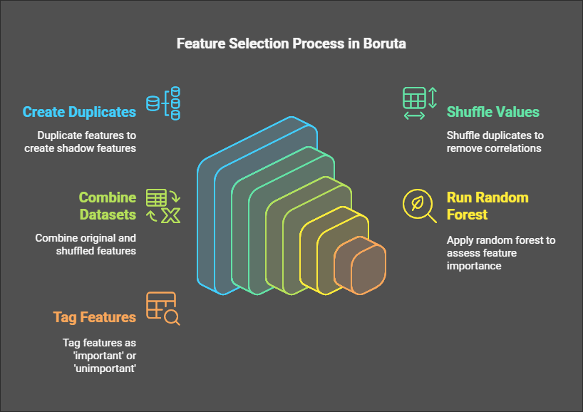
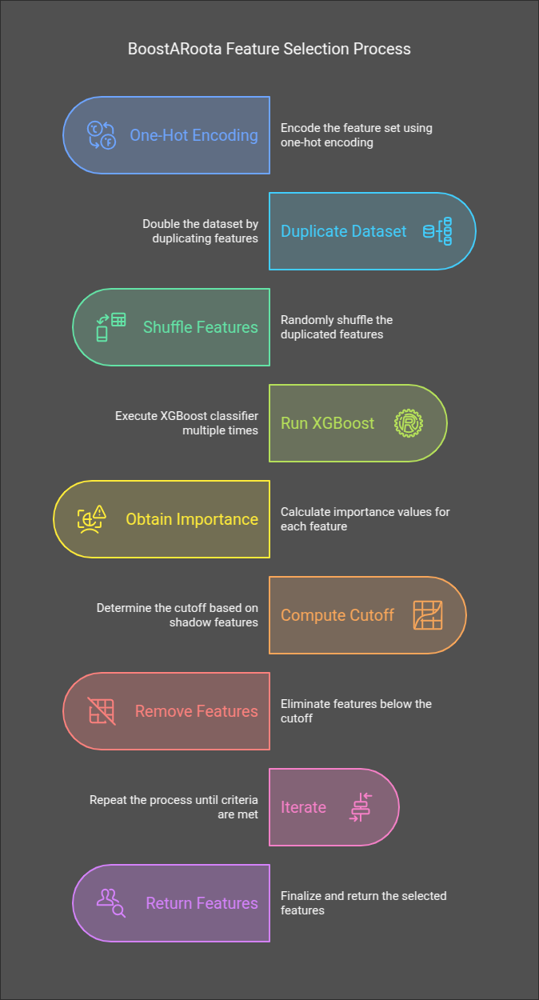
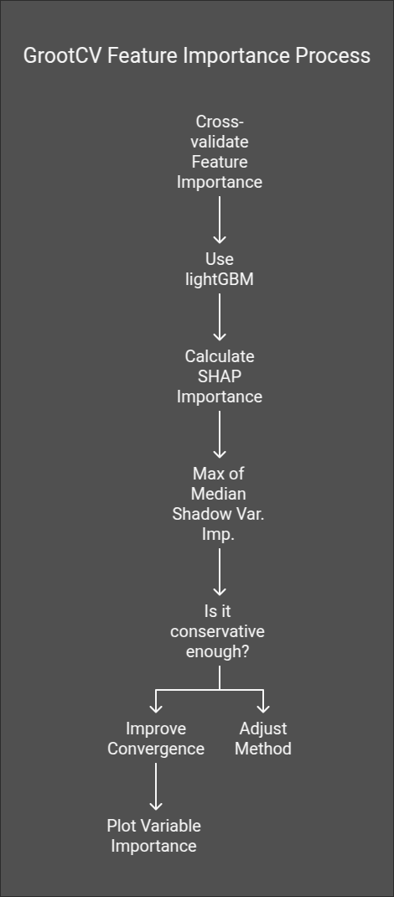

[buy me caffeine](https://ko-fi.com/V7V72SOHX)

   

[ARFS readthedocs](https://arfs.readthedocs.io/en/latest/#)

# All relevant feature selection

All relevant feature selection aims to find predictors carrying information about a response, including redundant predictors. These implementations compare fitted model importances with shuffled features. Results depend on the estimator, importance method and shadow threshold; the comparisons do not establish calibrated false-discovery control.

This package implements Leshy (based on Boruta), BoostAGroota (based on BoostARoota) and GrootCV. They expose sklearn-style fit/transform interfaces. Leshy and BoostAGroota accept compatible tree estimators that supply the requested importance method and, when used, sample weights. GrootCV uses LightGBM. ARFS also provides preprocessing and basic feature selection for missingness, cardinality, collinearity and model importance.

MRmr offers a separate relevance/redundancy ranking heuristic; its selected set need not be a subset of an all-relevant selector's output. Lasso selects a penalized GLM design and then refits its surviving columns without regularization. Combining it with `TreeDiscretizer` adds univariate nonlinear features. See the [method contracts](./docs/Methods%20overview.rst) for weight, scoring and inference limits.

Please note that one limitation of the lasso is that it treats the levels of a categorical predictor individually. However, this issue can be addressed by utilizing the `TreeDiscretizer`, which automatically bins numerical variables and groups the levels of categorical variables.

## Installation

`$ pip install arfs`

FastTreeSHAP is an optional compiled backend, separate from the runtime and `arfs[docs]` dependencies. Its compatibility with the current dependency matrix is not validated. Use the default SHAP paths for the core examples. Leshy and BoostAGroota warn and fall back to SHAP when it is missing; `VariableImportance(fastshap=True)` raises an import error before training.

See [documentation workflows](./docs/workflows.rst) for the local HTML build, Pandoc prerequisite and notebook execution scope.
The same guide records the tested Python/dependency snapshots and the limits of the selection experiments. An allowed dependency range is not evidence that every combination has been tested.

## Example

Examples (validation scope and optional prerequisites are recorded in the documentation workflows):

 - [Preprocessing](./docs/notebooks/preprocessing.ipynb)
 - [Basic FS (best before ARFS)](./docs/notebooks/basic_feature_selection.ipynb)
 - [Regression](./docs/notebooks/arfs_regression.ipynb)
 - [Classification](./docs/notebooks/arfs_classification.ipynb)
 - [LASSO and (G)LM feature selection](./docs/notebooks/lasso_feature_selection.ipynb)
 - [Passing custom params](./docs/notebooks/arfs_grootcv_custom_params.ipynb)
 - [Non-normal loss and sample weights](./docs/notebooks/arfs_non_normal_loss_and_sample_weight.ipynb)
 - [ARFS on GPU](./docs/notebooks/arfs_on_GPU.ipynb)
 - [Fast Shap](./docs/notebooks/arfs_shap_vs_fastshap.ipynb)
 - [Categoricals](./docs/notebooks/issue_categoricals.ipynb)
 - [Collinearity](./docs/notebooks/issue_collinearity.ipynb)
 - [Reducing run time for large data](./docs/notebooks/arfs_large_data_sampling.ipynb)
 - [Comparison to Boruta and BorutaShap](./docs/notebooks/arfs_boruta_borutaShap_comparison.ipynb)
 - [MRmr alternative](./docs/notebooks/mrmr_feature_selection.ipynb)
 - [MRmr vs ARFS](./docs/notebooks/mrmr_fs_VS_arfs.ipynb)

For imbalanced classification:
 - GrootCV's classification heuristic sets LightGBM `is_unbalance=True` when the largest class exceeds 80% of the unweighted rows. It does not estimate weighted prevalence.
 - For Leshy and BoostAGroota, you can pass the estimator with the relevant parameter (e.g. `class_weight = 'balanced'`)

## Boruta

The Boruta algorithm tries to capture all the important features you might have in your dataset with respect to an outcome variable. The procedure is the following:

 * Create duplicate copies of all independent variables. When the number of independent variables in the original data is less than 5, create at least 5 copies using existing variables.
 * Shuffle the values of added duplicate copies to remove their correlations with the target variable. It is called shadow features or permuted copies.
 * Combine the original ones with shuffled copies
 * Run a random forest classifier on the combined dataset and performs a variable importance measure (the default is Mean Decrease Accuracy) to evaluate the importance of each variable where higher means more important.
 * Then Z score is computed. It means mean of accuracy loss divided by the standard deviation of accuracy loss.
 * Find the maximum Z score among shadow attributes (MZSA)
 * Tag the variables as 'unimportant' when they have importance significantly lower than MZSA. Then we permanently remove them from the process.
 * Tag the variables as 'important' when they have importance significantly higher than MZSA.
 * Repeat the above steps for a predefined number of iterations (random forest runs), or until all attributes are either tagged 'unimportant' or 'important', whichever comes first.

At every iteration, the algorithm compares the Z-scores of the shuffled copies of the features and the original features to see if the latter performed better than the former. If it does, the algorithm will mark the feature as important. In essence, the algorithm is trying to validate the importance of the feature by comparing with randomly shuffled copies, which increases the robustness. This is done by simply comparing the number of times a feature did better with the shadow features using a binomial distribution. Since the whole process is done on the same train-test split, the variance of the variable importance comes only from the different re-fit of the model over the different iterations.

## BoostARoota

BoostARoota follows closely the Boruta method but modifies a few things:

 * One-Hot-Encode the feature set
 * Double width of the data set, making a copy of all features in the original dataset
 * Randomly shuffle the new features created in (2). These duplicated and shuffled features are referred to as "shadow features"
 * Run XGBoost classifier on the entire data set ten times. Running it ten times allows for random noise to be smoothed, resulting in more robust estimates of importance. The number of repeats is a parameter than can be changed.
 * Obtain importance values for each feature. This is a simple importance metric that sums up how many times the particular feature was split on in the XGBoost algorithm.
 * Compute "cutoff": the average feature importance value for all shadow features and divide by four. Shadow importance values are divided by four (parameter can be changed) to make it more difficult for the variables to be removed. With values lower than this, features are removed at too high of a rate.
 * Remove features with average importance across the ten iterations that is less than the cutoff specified in (6)
 * Go back to (2) until the number of features removed is less than ten per cent of the total.
 * Method returns the features remaining once completed.

The original algorithm above is historical context. BoostAGroota's current threshold is the maximum shadow **mean across iterations**, divided by `cutoff`. Per-iteration importances are normalized; signed permutation scores use their absolute total and require positive mean evidence. This empirical comparison does not establish false-discovery control.

## Modifications to Boruta and BoostARoota

 I forked both Boruta and BoostARoota and made the following changes (under PR):

**Boruta --> Leshy**:

  - Categorical features are detected and encoded. Category codes need the estimator's categorical handling; encoding alone does not establish better selection or prediction than one-hot encoding.
  - LightGBM is supported; runtime depends on the data, estimator and parameters
  - Accept compatible sklearn-style tree estimators; CatBoost/XGBoost execution is outside the tested runtime matrix
  - Observation weights affect fitting and validation scoring where supplied; their statistical meaning depends on the estimator and loss
  - Supports 3 different feature importances: native, SHAP and permutation. Native being the least consistent(because of the imp. biased towards numerical and large cardinality categorical) but the fastest of the 3. Indeed, the impurity var.imp. are biased en sensitive to large cardinality (see [scikit demo](https://scikit-learn.org/stable/auto_examples/inspection/plot_permutation_importance.html#sphx-glr-auto-examples-inspection-plot-permutation-importance-py))

**BoostARoota --> BoostAGroota**:

  - Replace XGBoost with LightGBM, you can still use tree-based scikitlearn models
  - Replace native var.imp by SHAP var.imp. Indeed, the impurity var.imp. are biased en sensitive to large cardinality (see [scikit demo](https://scikit-learn.org/stable/auto_examples/inspection/plot_permutation_importance.html#sphx-glr-auto-examples-inspection-plot-permutation-importance-py)). Moreover, the native var. imp are computed on the train set, here the data are split (internally) in train and test, var. imp computed on the test set.
  - Categorical handling depends on the estimator. Fit any encoder on training rows only and identify categorical columns for estimators that require it. The validation does not compare encoding strategies or establish categorical superiority.
  - Observation weights do not automatically make SHAP row averages weight-adjusted population explanations. VariableImportance averages validation rows equally; GrootCV averages each fold's training rows.

## GrootCV, a new method

**New: GrootCV**:

  - Repeated-fold feature importance, based on LightGBM only. Validation rows drive early stopping; SHAP summaries use fold training rows.
  - the feature importance is derived using SHAP importance
  - Take the maximum shadow median across folds/repeats, divided by `cutoff`, and retain real medians at or above it. This is an empirical threshold, not calibrated false-discovery control.
  - Not based on a given percentage of cols needed to be deleted
  - Plot method for var. imp

## References

**Theory**

 - [Consistent feature selection for pattern recognition in polynomial time](https://www.jmlr.org/papers/volume8/nilsson07a/nilsson07a.pdf)
 - [Maximum Relevance and Minimum Redundancy Feature Selection Methods for a Marketing Machine Learning Platform](https://eng.uber.com/research/maximum-relevance-and-minimum-redundancy-feature-selection-methods-for-a-marketing-machine-learning-platform/)

**Applications**

 - [The Boruta paper](https://www.jstatsoft.org/article/view/v036i11/v36i11.pdf)
 - [The python implementation](https://github.com/scikit-learn-contrib/boruta_py)
 - [BoostARoota](https://github.com/chasedehan/BoostARoota)

